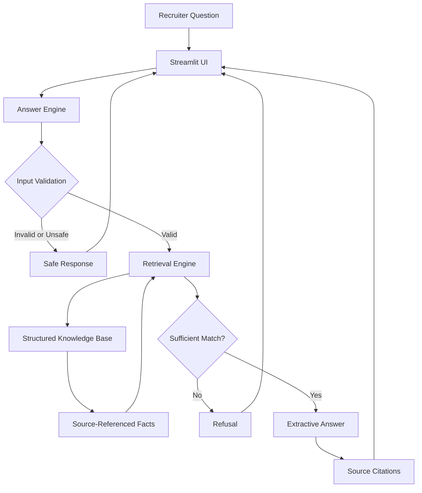

# System Architecture

## Component Responsibilities

- `app.py`: User interface and source display.
- `answer_engine.py`: Input checks, refusal, and answer assembly.
- `retrieval.py`: Lexical search and fact ranking.
- `knowledge.py`: JSON loading and schema validation.
- `data/knowledge.json`: Structured professional facts.
- `data/sources/`: Supporting source documents.
- `evaluate.py`: Automated evaluation.
- `tests/`: Unit and regression tests.
